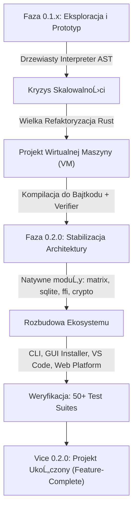

# 🌌 JÄ™zyk Programowania Vice (v0.2.0 — Final Release)
### Oficjalna Kronika, Architektura i Podręcznik Projektu

[](https://github.com/Slodziak985/Vice-Programming-Language)
[](https://github.com/Slodziak985/Vice-Programming-Language)
[](https://github.com/Slodziak985/Vice-Programming-Language)
[](https://www.rust-lang.org/)
[](LICENSE)

> *"Kod powinien jasno pokazywać, skąd dane przychodzą, jak są przekształcane i dokąd zmierzają. Bez magii, bez ukrytych efektów ubocznych."*  
> — **Slodziak985, Twórca i Główny Architekt Języka Vice**

---

## đź“– 1. Geneza i Filozofia Vice

Projekt **Vice** narodził się z potrzeby stworzenia języka programowania o **bezwzględnie czytelnym przepływie danych** i **deterministycznym środowisku wykonawczym**. 

Podczas gdy współczesne języki programowania stają się coraz bardziej wieloparadygmatowe, skomplikowane i przeładowane składniowym lukrem, Vice stawia na surową prostotę, architektoniczną przejrzystość oraz izolowane środowisko wykonawcze (sandboxing).

### GĹ‚Ăłwne filary filozofii Vice:
1. **Reguła Trzech Strzałek**:
   - `=>` — **Wiązanie i Inicjalizacja**: Deklaracja zmiennej (`let x => 42;`), dopasowanie w `match` lub nazwanie argumentu.
   - `<-` — **Emisja i Wyjście**: Wyprowadzenie wartości do strumienia (`emit <- wartosc;`), zgłoszenie niepowodzenia w teście (`fail <- "komunikat";`).
   - `->` — **Przepływ i Wejście**: Wskazanie typu zwracanego przez funkcję (`fn suma() -> int`) lub skierowanie wejścia do zmiennej (`input -> bufor;`).
2. **Determinizm i Semantyka Wartości**:
   Struktury `data` oraz tablice `array` posiadają semantykę wartości (*pass-by-value / immutable updates*). Modyfikacje struktur nie wywołują niejawnych skutków ubocznych w odległych częściach programu.
3. **Bezpieczeństwo w epoce AI**:
   Polecenie `vice schema` generuje ścisłą, maszynową specyfikację JSON wszystkich modułów i ich sygnatur. Modele AI mogą pisać kod w Vice bez halucynacji o nieistniejących funkcjach, a wirtualna maszyna może uruchamiać taki kod w bezpiecznej piaskownicy.
4. **Wbudowane obliczenia macierzowe w stylu NumPy**:
   Moduł `matrix` jest zintegrowany natywnie w jądrze języka, umożliwiając implementację warstw sieci neuronowych i algebry liniowej bezpośrednio w składni Vice.

---

## ⏳ 2. Kronika Rozwoju: Droga od Prototypu do Wersji 0.2.0

Droga do ukończenia Vice była pełna odważnych decyzji architektonicznych, radykalnych refaktoryzacji i nieustannego dążenia do inżynieryjnej doskonałości:



### Faza I: Narodziny i wczesne eksperymenty (v0.1.x)
W początkowej fazie Vice był dynamicznie interpretowanym językiem drzewiastym. Składnia eksperymentowała z mechanizmem `@mount` do łączenia plików oraz instrukcją `output <-`. Choć pozwalało to na błyskawiczne prototypowanie prostych gier i skryptów, interpreter drzewiasty miał swoje ograniczenia: brakowało rygorystycznej kontroli typów, zużycie pamięci było trudne do przewidzenia, a optymalizacja pętli napotykała barierę narzutu węzłów AST.

### Faza II: Wielka Refaktoryzacja i Narodziny Maszyny Wirtualnej (Przejście do v0.2.0)
Autor podjął kluczową decyzję inżynieryjną: **całkowite odrzucenie powolnego interpretera drzewiastego i przepisanie rdzenia w Rust na model wieloetapowego kompilatora bajtkodu oraz weryfikowanej maszyny wirtualnej (Stack-based VM)**:
- Wprowadzono **Loader z detekcjÄ… cykli importu**,
- Zbudowano **Semantic Analyzer** sprawdzający typy, kontrakty cech (`traits`) oraz poprawność przepływu sterowania przed uruchomieniem ani jednej linijki bajtkodu,
- Zaimplementowano **Verifier**, który skanuje skompilowane instrukcje (Chunki) i gwarantuje, że skoki i ramki stosu nie wywołają *undefined behavior*,
- Przeprojektowano kontrakt projektowy na nowoczesny standard `vice.toml`.

### Faza III: Ekosystem, Moduły Natywne i Narzędzia
Gdy silnik osiągnął stabilność, zintegrowano z nim kluczowe moduły przemysłowe:
- **`matrix`**: MnoĹĽenie, transpozycja, iloczyn skalarny, reshape, wektory wag neuronowych,
- **`sqlite`**: Bezpieczne, wbudowane bazy danych relacyjnych prosto z Vice,
- **`ffi`**: Możliwość wywoływania bibliotek dynamicznych (.dll / .so) zgodnych z C-ABI,
- **`crypto`** & **`regex`**: SHA256, Base64, silnik wyrażeń regularnych,
- **Desktop & Installer**: Obsługa okien i akceleracji sprzętowej (`wgpu`, `winit`), dźwięk (`rodio`) oraz graficzny instalator Windows oparty o `egui`.

### Faza IV: Zwieńczenie i Zamknięcie Projektu
Vice przeszedł rygorystyczną serię ponad **50 zautomatyzowanych zestawów testów integracyjnych** (testujących sandboxing pamięci, odporność parsera, limity alokacji, rekurencję i operacje numeryczne). Osiągając bezkompromisową stabilność, projekt został formalnie uznany za **ukończony**.

---

## 🏛️ 3. Architektura Wewnętrzna (Deep Dive)

Pipeline wykonawczy w Vice 0.2.0 jest czysty, modułowy i w pełni zaimplementowany w języku Rust:

```
[ Kod źródłowy *.vice ]
         │
         â–Ľ
 1. Loader (Resolving use, detekcja cykli, weryfikacja granic projektu)
         │
         â–Ľ
 2. Lexer (Strumień tokenów ze spanami: linia, kolumna, długość)
         │
         â–Ľ
 3. Parser (Budowanie Drzewa Składni Abstrakcyjnej - AST)
         │
         â–Ľ
 4. Semantic Analyzer (RozwiÄ…zywanie nazw, typĂłw, traits, efektĂłw)
         │
         â–Ľ
 5. Bytecode Compiler (Generowanie ChunkĂłw bajtkodu)
         │
         â–Ľ
 6. Verifier (Statyczna weryfikacja niezmiennikĂłw bajtkodu i skokĂłw)
         │
         â–Ľ
 7. Stack VM (Wirtualna Maszyna: ramki wywołań, ochrona stosu, pamięć)
         │
         â–Ľ
[ Wynik wykonania / Emisja bufora wyjścia ]
```

### Specyfikacja podsystemĂłw:
- **Loader**: Gwarantuje bezpieczeństwo ścieżek — importy `use` nie mogą wychodzić poza root projektu ani odwoływać się do niebezpiecznych ścieżek bezwzględnych.
- **Formatter (`vice fmt`)**: Zintegrowany z AST i tokenami, dba o zachowanie komentarzy (`#`, `//`) i prawidłowe formatowanie 4 spacjami.
- **Wirtualna Maszyna (VM)**: Obsługuje stos wartości (liczby `f64`/`int`, stringi, bool, struktury `data`, enumi, mapy, tablice). VM jest w pełni resetowalna i izolowana.

---

## 💻 4. Prezentacja Składni i Przykłady Kodu

### 1. Klasyczny "Witaj Świecie" i Jawny Przepływ
```vice
use "std/io.vice";

@entry
fn main() {
    let powitanie => "Witaj w świecie Vice 0.2.0!";
    emit <- powitanie;
}
```

### 2. Warstwa Sieci Neuronowej z Użyciem Modułu `matrix`
Przykład obliczający krok w przód (*forward pass*) warstwy neuronowej:
```vice
# Forward pass: Y = W * X
fn main() {
    emit <- "--- Vice Neural Layer Simulation ---";

    # Wagi neuronowe (2 neurony, 3 wejscia): macierz 2x3
    mut weights_data = [0.5, -0.2, 0.8, 0.1, 0.9, -0.4];
    mut W = matrix.from_array(weights_data, 2, 3);

    # Wejscie (3 cechy): macierz 3x1 (wektor kolumnowy)
    mut inputs_data = [1.0, 2.0, 0.5];
    mut X = matrix.from_array(inputs_data, 3, 1);

    # Mnozenie macierzowe: Y = W * X (wynik 2x1)
    mut Y = matrix.mul(W, X);
    emit <- "Wyjscie neuronow:";
    emit <- matrix.to_array(Y);

    # Suma wszystkich wag
    let suma => matrix.sum(W);
    emit <- suma;
}
```

### 3. Struktury Danych, Typy i Pattern Matching
```vice
data Punkt {
    x: int => 0;
    y: int => 0;
}

enum Status {
    Aktywny,
    Wstrzymany,
    Blad(string)
}

fn sprawdz(status: Status) -> string {
    return match (status) {
        Status.Aktywny => "System dziala.",
        Status.Wstrzymany => "Oczekiwanie.",
        Status.Blad(komunikat) => komunikat,
        _ => "Nieznany stan."
    };
}
```

### 4. Wbudowane Testy Jednostkowe
```vice
@test
fn test_arytmetyki() {
    let a => 10;
    let b => 20;
    if (a + b != 30) {
        fail <- "Blad dodawania w Vice!";
    }
}
```

---

## 🛠️ 5. Zestaw Narzędzi CLI

Wszystkie operacje projektowe wykonuje uniwersalna binarka `vice`:

| Polecenie | Opis |
|---|---|
| `vice run <plik\|.>` | Kompiluje program do bajtkodu i natychmiast wykonuje go w VM |
| `vice check <plik\|.>` | Wykonuje pełny pipeline (Loader $\to$ Parser $\to$ Semantyka) bez uruchamiania |
| `vice test <.>` | Automatycznie wykrywa i uruchamia testy oznaczone adnotacjÄ… `@test` |
| `vice fmt <plik\|.>` | Formatuje pliki źródłowe zachowując komentarze i strukturę |
| `vice schema` | Zwraca pełny schemat JSON API dostępnego dla modeli AI |
| `vice new <nazwa>` | Generuje kompletny szablon nowego projektu z `vice.toml` |
| `vice migrate` | Automatycznie konwertuje kod ze starego formatu v0.1.1 do standardu v0.2.0 |

---

## 📦 6. Zawartość Paczki Wydaniowej (Release Artifacts)

Kompilacja dystrybucyjna dla Windows x86-64 zawiera:
- `vice.exe` — Główny kompilator, weryfikator i maszyna wirtualna z obsługą desktop/GPU.
- `ViceInstaller.exe` — Dedykowany instalator Windows z graficznym interfejsem użytkownika.
- `vicetool.exe` — Narzędzie pomocnicze (Vice Asset/App Manager).
- `std/` — Katalog standardowych modułów i bibliotek Vice SDK.
- `examples/` — Przykłady referencyjne (gry, algorytmy, operacje macierzowe).

---

## 🌟 7. Epilog i Dziedzictwo Projektu

Projekt Vice udowodnił, że niezależny twórca oprogramowania, wyposażony w determinację, pasję i nowoczesne narzędzia systemowe, jest w stanie zaprojektować i zbudować od zera kompletną platformę programistyczną.

Vice nie musi rywalizować z gigantami rynku, by mieć sens. Jego wartość tkwi w:
- **Kunszcie inĹĽynierskim**: Czystym, przetestowanym i bezpiecznym kodzie Rust,
- **Wartości edukacyjnej**: Stanowi żywy, działający podręcznik konstrukcji maszyn wirtualnych dla studentów i pasjonatów informatyki,
- **Precyzji**: Pokazuje, jak czytelny i przewidywalny może być język zorientowany na jawny przepływ danych.

Projekt osiągnął swój cel i przechodzi w stan spoczynku jako dzieło kompletne.

---

**Autor i Architekt**: Slodziak985  
**Data wydania v0.2.0**: PaĹşdziernik 2026  
**Język rdzenia**: Rust 2021  
*Wszelkie prawa zastrzeĹĽone. Projekt Open Source.*

